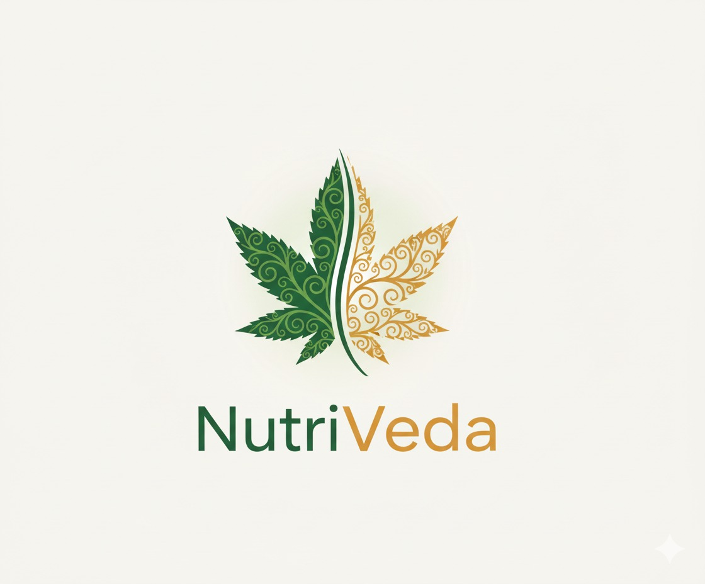

#  NutriVeda: AI-Powered Ayurvedic Nutrition & Personalized Diet Planning Platform


> A healthcare-focused nutrition platform that combines Ayurvedic principles, AI-powered food analysis, and personalized diet planning to promote healthier lifestyle choices.

---

## 📖 Overview

NutriVeda is an intelligent nutrition and wellness platform designed to assist users in understanding their dietary habits through Ayurvedic principles and modern AI technologies.

The platform enables users to assess their body constitution (Dosha), receive personalized diet recommendations, analyze food items using AI, monitor their nutritional progress, and manage patient information through a secure healthcare-oriented dashboard.

By combining evidence-based nutrition, Ayurvedic recommendations, AI-assisted food recognition, and personalized meal planning, NutriVeda aims to make healthy living more accessible and interactive.

---

## ✨ Project Highlights

- 🥗 Personalized Ayurvedic diet planning
- 🧬 Dosha assessment and constitution analysis
- 🤖 AI-powered food recognition
- 🔍 Smart nutrition search
- 📈 Progress tracking and health monitoring
- 📄 Downloadable diet reports
- 👨‍⚕️ Patient and dietitian management
- 🔐 Secure authentication with Supabase


---

## 🛠️ Tech Stack

| Category | Technologies |
|----------|--------------|
| Frontend | Next.js 14, React 18 |
| Backend | Next.js API Routes |
| Database | Supabase |
| Authentication | Supabase Auth |
| AI Services | Gemini API, OpenRouter |
| Machine Learning | TensorFlow, OpenCV |
| Data Processing | Python |
| Styling | Tailwind CSS |

---

## 📊 Key Outcomes

- Developed a healthcare-focused nutrition platform integrating Ayurvedic knowledge with modern AI.
- Implemented personalized diet planning based on Dosha assessment.
- Integrated AI-assisted food recognition using TensorFlow and OpenCV.
- Built secure patient management using Supabase Authentication.
- Designed an interactive dashboard for nutritional tracking and meal recommendations.
- Enabled downloadable reports for personalized diet plans.

---

## 🚀 Core Features

- Patient registration and profile management
- Ayurvedic Dosha prediction
- Personalized meal planning
- AI-powered food detection
- Food nutrition database
- AI chatbot assistance
- Progress tracking dashboard
- Downloadable diet reports

---

## ⚡ Getting Started

### Prerequisites

- Node.js 18+
- npm
- Python 3.8+
- Supabase Project
- Gemini API Key

### Installation

```bash
npm install
```

### Python Dependencies

```bash
python -m pip install -r requirements.txt
```

### Environment Variables

Create `.env.local`

```env
NEXT_PUBLIC_SUPABASE_URL=
NEXT_PUBLIC_SUPABASE_ANON_KEY=
OPENROUTER_API_KEY=
NEXT_PUBLIC_APP_URL=http://localhost:3000
GEMINI_API_KEY=
```

### Run

```bash
npm run dev
```

Visit

```
http://localhost:3000
```

---

## 🧩 Project Structure

```text
app/
components/
CV/
lib/
public/
hooks/
scripts/
```

---

## 🤝 Team Project

NutriVeda was developed collaboratively as a Smart India Hackathon (SIH) project.

The repository represents the complete application, with contributions spanning frontend development, backend integration, AI-powered nutrition analysis, database management, and UI/UX design.

